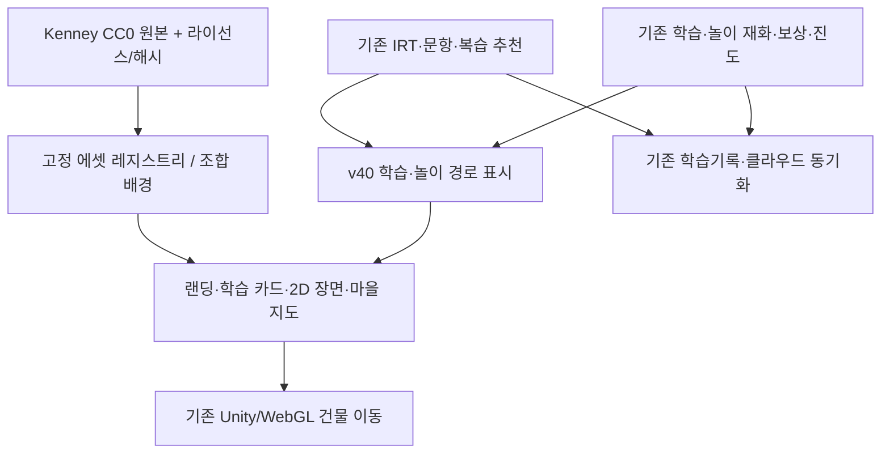

# 태희·세희 마법마을 v40 — 공개 CC0 게임 에셋 기반 세계관 통합

2026-11-02 · 개발 브랜치 `feat/magic-village-v40-open-art-20261102`

## 결론 및 구현 범위

기존 v39의 실제 수학·국어·영어·한자·경시대회, 별 보상, 성장, 연못·바다, 직업사전 및 두 어린이의 학습 이력을 삭제·초기화하지 않고, **공개 CC0 게임 에셋으로 화면의 시각 언어를 통합하는 v40 개발 버전**을 구현했다. 코어 학습 알고리즘을 무근거로 다시 짜지 않고, 화면/지도/추천 경로와 에셋 레지스트리를 독립 모듈로 분리했다.

| 범위 | v40 변경 | 유지되는 계약 |
|---|---|---|
| 랜딩 | 공개 에셋으로 직접 조립한 동화풍 2.5D 섬, 큰 프로필·이동 버튼 | 태희·세희 선택·주소 전달 |
| 배움터 | 같은 팩의 과목별 건물 아트, IRT 추천 3걸음+놀이 진입 경로 | 정답·IRT·보상 판정, 뱁수 원화 |
| 마을 지도 | 13개 공통 장소 레지스트리, 실제 이동 버튼 11개, 큰 아트 카드, 이야기 모험 접기 | Unity 건물 핫스팟/이동명령, 별 경제 |
| 2D 모드 | 새 섬 배경과 공통 시각 스타일 | 느린 기기용 2D 및 문제풀이 |
| 해양·정원 | 연못·바다·정원의 아트 조합, 기존 생물 원화 보존 | 기존 물고기 종·성장/시간·자원 비용 |
| 영속성 | 변경하지 않음 | `Progress`, `CloudSync`, Supabase, 복수 기기 승계, 기존 로컬스토리지 키 |
| 3D 런타임 | **Unity WebGL 빌드는 이 단계에서 교체하지 않음** | 기존 3D 플레이·충돌·이동·애니메이션 보존 |

### 공개 에셋 출처와 라이선스

- **Kenney Sketch Town 1.0**, 제작/배포 Kenney: https://opengameart.org/content/sketch-town
  - 공식 저작물 라이선스 파일 확인: `assets/kenney-sketch-v40/LICENSE_BASE.txt` (CC0 1.0)
  - 내려받은 ZIP SHA-256: `bd8bb09cb33c922347c643242a04de5ea14206511efe1be5cd7b975a2563b77e`
- **Kenney Sketch Town Expansion**, 제작/배포 Kenney: https://opengameart.org/content/sketch-town-expansion
  - 라이선스 파일: `assets/kenney-sketch-v40/LICENSE_EXPANSION.txt` (CC0 1.0)
  - ZIP SHA-256: `46959e14f08eb73c2a0cf63148f37858b62684edfc66b997f822518f91feaceb`

원본 팩에서 **PNG 28개**를 선별했고, 동일한 원본만 사용해 **13개 장소 스프라이트 + 배경 섬 1개 = 총 14개**의 조합 이미지를 새로 제작했다. 외부 팩의 예시 스크린샷/브랜드 로고는 서비스 UI에 포함하지 않았다. 두 팩은 CC0이므로 상업적 활용 및 수정 가능; 감사 표시는 선택사항이지만 Kenney 출처를 문서에 기록했다.

- 원본 레지스트리 및 SHA-256: `assets/kenney-sketch-v40/manifest.json`
- 조합 이미지 무결성: `assets/kenney-sketch-v40/composite/derivatives.json`
- 재수입 명령: `python3 scripts/import-kenney-v40.py [base.zip] [expansion.zip]`
- 이미지 재빌드 명령: `python3 scripts/build-kenney-scenes-v40.py` (개발 환경에 Pillow 필요, **실행 앱에는 불필요**)
- 마을-에셋 매핑: `platform/world-art-v40.js`, 사용자 브라우저에 외부 이미지 네트워크 요청 없음

## 코드 구조

- `platform/adventure-loop-v40.js`: 추천 임무의 3걸음을 화면용 모델로 만드는 **읽기 전용 순수 함수**. 임의의 정답 채점/숙련도 판정, 별 보상, 기록 저장을 수행하지 않는다.
- `platform/world-art-v40.js`: 이미지 경로·장소 ID를 고정된 화이트리스트로 노출. 임의 경로·URL을 구성하지 않는다.
- `entry-world-v40.css`, `learning-world-v40.css`, `village/world-ui-v40.css`: 큰 글자·큰 터치영역·색상·컨테이너 일관화; 접근성 포커스 및 reduced-motion 지원.
- 원래 태희·세희 요정 / Bebsu / 연못·바다 실제 생물은 기존 원화를 유지하여 기존 자산을 보존한다.

## 기능 안전 계약

1. `games/`의 원문 8,462문항, KMA 기출 원본, `games/irt-bank.json`을 수정하지 않음.
2. `platform/progress.js`, `platform/cloud-sync.js`, `platform/irt.js`, `platform/rewards.js`, `platform/play-balance.js`, `platform/pond-session.js`, `supabase/`, `village/Build/`을 수정하지 않음.
3. 기존 `tae`, `se` 프로필 및 재화/관계/성장 기록을 서로 섞거나 초기화하지 않음.
4. 학습 참여를 정답 개수만으로 평가하거나 놀이를 과도하게 금지하지 않음. 기존 새 학습 시도 기반 놀이 균형 게이트를 그대로 사용.
5. 3D 이동은 기존 `GO_TO_DISTRICT` 메시지를 활용하며 거리에 따른 경로/핫스팟 도착 판정은 Unity 런타임에 위임.

## 검증

- `npm run check`: **PASS** (기존 학습/IRT/보상/가족/해양/직업/문항/키패드 등 회귀와 v40 신규 테스트).
- `npm run check:world:v40`: **PASS** (28개 CC0 자산, 14개 자체 조합 이미지 SHA, 경로 화이트리스트, 3걸음 정책).
- `npm run qa:world:v40`: **PASS** (브라우저 독립 합성 상태: Galaxy 390×844, 태블릿 1024×768, 소형 360×740. 입장, 두 아이 선택/전달, 학습 3걸음, 이미지 다운로드, 2D 모험 지도 11곳, 수평 오버플로·JS 오류 없음).
- `READABLE_QA_ORIGIN=http://127.0.0.1:4595 npm run qa:refactor`: **PASS** (세희 3문항, 태희 5문항 완료, 다음 학습, 터치 영역).
- `CLOUD_QA_ORIGIN=http://127.0.0.1:4595 npm run qa:cloud:canonical`: **PASS** (독립 모의 기기 둘, 학습 시도 5건, 충돌 두 건 및 재시도, 형제별 진도 분리·무중복).
- `UNIFIED_ORIGIN=http://127.0.0.1:4595 npm run qa:3d:v39`: **PASS** (실제 Unity WebGL: 태희 1024×768 및 세희 390×844에서 영어학교 이동 → 문제 응답 → 연못 도착, JS 오류 없음).

스크린샷/브라우저 QA는 `/tmp/sparkle-v40-art-qa/`에 기록. 운영 Supabase 및 실제 아이의 진도는 확인·수정하지 않았다.

## 실제 화면 미리보기 (합성 브라우저 상태)

- [모바일 시작 화면](previews/v40/galaxy-landing.png) · [모바일 학습 3걸음](previews/v40/galaxy-learning.png) · [모바일 마을 지도](previews/v40/galaxy-map.png)
- [태블릿 시작 화면](previews/v40/tablet-landing.png)

위 이미지는 가상 브라우저/합성 데이터로 캡처했으며 실제 자녀의 학습기록을 노출하지 않는다. UI QA 확인용이며 기기 실측 검수의 대체물이 아니다.

## 리스크와 정식 전환 게이트

**이것은 프로덕션 v39를 교체한 릴리스가 아니라 격리 개발 브랜치의 v40 개발 빌드다.**

- Unity 3D 모델 자체의 재텍스처링 및 모든 NPC/캐릭터 애니메이션 통일은 **Unity 원본 프로젝트를 확보하고 실제 3D 에셋로 변환/임포트하는 별도 단계**가 필요하다. 웹 UI의 공개 PNG 교체를 Unity 씬 교체라고 주장하지 않는다.
- 브라우저 에뮬레이션은 물리적 갤럭시·iPad의 실제 터치/GPU·메모리·웹뷰 품질을 보증하지 않는다.
- 실기기에서 폰·태블릿 세로/가로, 숫자 키패드, 학습 완료 및 별 적립, 연못 체류 요금, 두 기기 간 기존 가족 데이터 승계 확인 후에만 `main` 병합/배포.
- 회귀 시 기존 v39 커밋 `7b1da4d73667b186785caa7a6cacfade40a8a219`로 웹 배포를 돌리되, **진도나 운영 데이터는 초기화하지 않는다.**

## 다음 주요 버전에서 구현할 원칙

- Unity 모델/씬의 공개 CC0 3D 팩(기존 2D 타일과 색상·실루엣 일치) 도입 및 NPC·물고기 행동 개선.
- 현행 복잡한 UI를 영역별 컴포넌트로 계속 분해, 이펙트/로딩/맵/데이터 어댑터 계층 분리.
- 정답률 상승만이 아니라 IRT 숙련도·반응 패턴 다양성·오답 복습의 균형으로 반복 단조로움 억제; 보호자 관찰로 개입 수준 확인.
- 선택형 쉬는 시간과 학습 다양성의 균형, 단순 채굴/꾸미기만 반복되도록 설계하지 않음.
